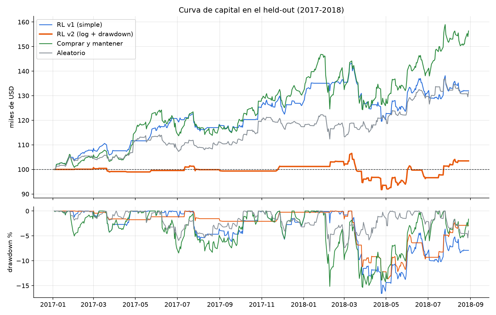
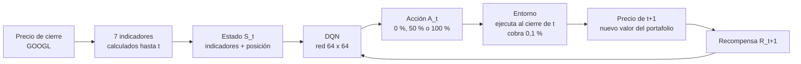
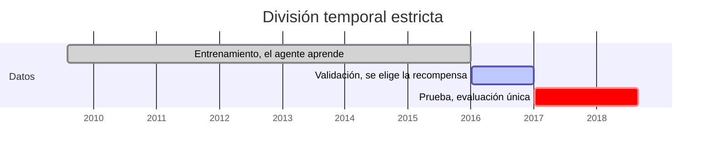

<div align="center">

# Agente Inversor

### ¿Puede una inteligencia artificial que aprende por ensayo y error invertir mejor que la estrategia más simple del mercado?

Un agente de **Deep Reinforcement Learning** decide cada día cuánto capital mantener invertido en **GOOGL**, paga costos reales por operar y se evalúa **una sola vez** en dos años que nunca vio.

[](https://github.com/dialrigo/agente-inversor/actions/workflows/ci.yml)


[Resultados](#-resultados-en-datos-nunca-vistos) · [Cómo funciona](#-cómo-funciona) · [Reproducir](#-reproducir-el-experimento) · [Rúbrica](#-dónde-está-cada-criterio-de-la-rúbrica) · [Equipo](#-equipo)

</div>

---

## Resumen general del proyecto

| | |
|---|---|
| **El reto** | Con 100.000 USD, decidir cada día si mantener el 0 %, el 50 % o el 100 % del capital en GOOGL, pagando 0,1 % por cada operación |
| **El agente** | DQN (Stable-Baselines3) que observa 7 indicadores técnicos y su propia posición |
| **El rigor** | Entrena con 2009 a 2015, elige su recompensa con 2016 y se evalúa **una única vez** en 2017 y 2018, sin reajustar nada |
| **La respuesta** | **No superó a comprar y mantener.** Y entender por qué es el verdadero hallazgo del proyecto |

> *"Un resultado negativo no implica necesariamente un mal proyecto. La rigurosidad de la formulación, la evaluación y el análisis es más importante que obtener un retorno elevado."*

---

## Resultados en datos nunca vistos

**Periodo de prueba: 3 de enero de 2017 a 29 de agosto de 2018 (418 días).** Todas las estrategias parten de 100.000 USD y pagan el mismo costo de 0,1 %.

| Estrategia | Retorno acumulado | Máxima caída | Costos | Cambios de posición | Exposición media | Sharpe |
|---|---:|---:|---:|---:|---:|---:|
| **Agente RL v2** (elegido en validación) | **+3,46 %** | 13,87 % | 5.449 USD | 68 | 18 % | 0,26 |
| Agente RL v1 (descartado en validación) | +31,99 % | 16,57 % | 10.540 USD | 94 | 61 % | 1,21 |
| Comprar y mantener | **+56,36 %** | 15,36 % | 100 USD | 1 | 100 % | 1,45 |
| Aleatorio (media de 20 semillas) | +4,95 % | 14,72 % | 19.102 USD | 278 | 51 % | 0,27 |

<p align="center">
  
</p>

### Cuatro hallazgos que explican el resultado

1. **La recompensa moldeó un inversionista demasiado prudente.** Penalizar el aumento de la caída desde el máximo enseñó al agente que el efectivo nunca castiga. Por eso pasó cerca del 80 % de los días en efectivo durante la validación, mantuvo una exposición media de apenas 18 % en la prueba y se perdió el rally de 2017. Es un caso claro de *reward hacking*.
2. **El mercado cambió de régimen.** En 2016 quedarse fuera fue rentable; en 2017 y 2018 GOOGL subió 56 %. La versión descartada (v1) habría rendido +32 % en la prueba. No se cambió la elección al verlo, porque hacerlo habría invalidado la evaluación.
3. **Operar cuesta.** El agente pagó en costos más de lo que ganó, y concentró sus idas y vueltas en la turbulencia de 2018.
4. **La ventaja en validación no era estable.** Al reentrenar v2 con cuatro semillas, su retorno en 2016 promedió +1,4 % ± 5,4 %, frente al +9,0 % de la corrida oficial; la elección dependía en buena parte de la semilla. Detalle en [`docs/experimentos/optuna_y_semillas.md`](docs/experimentos/optuna_y_semillas.md).

El análisis completo está en [`docs/informe/07_evaluacion.md`](docs/informe/07_evaluacion.md) y [`docs/informe/08_anomalia.md`](docs/informe/08_anomalia.md).

---

## Cómo funciona





| Componente | Decisión de diseño |
|---|---|
| **Datos** | GOOGL diario del paquete `gym_anytrading` (`STOCKS_GOOGL`), dataset común del curso, ya ajustado por el split de 2014 |
| **Estado** | Retornos de 1, 5 y 20 días; distancia a las medias de 20 y 50 días; volatilidad de 20 días; RSI de 14 días; posición actual. Normalizados con estadísticas de entrenamiento |
| **Acciones** | Fracción objetivo del capital invertido: 0 %, 50 % o 100 % |
| **Ejecución** | Decide con el cierre de t y opera a ese precio; el precio de t+1 solo se usa después |
| **Costo** | 0,1 % del monto negociado, incluidos los rebalanceos diarios del 50 % |
| **Recompensas** | v1 retorno simple · **v2 retorno logarítmico con penalización del aumento de la caída (elegida)** · v3 retorno logarítmico como control |
| **Algoritmo** | DQN de Stable-Baselines3, red MLP 64 × 64, 150.000 pasos, episodios de un año con inicio aleatorio |
| **Selección** | Mayor cociente entre retorno y máxima caída en validación, fijado antes de abrir la prueba |

### Protocolo contra la fuga de información

- El periodo de prueba **no está registrado** como entorno de Gymnasium; solo `investor_eval.run(..., "test")` puede abrirlo.
- Los indicadores usan ventanas que terminan en t, y una **prueba automática** verifica que no cambian al borrar el futuro.
- La normalización y el análisis exploratorio usan **solo entrenamiento y validación**.
- Recompensa, hiperparámetros y arquitectura se fijaron **antes** de abrir la prueba, y todo queda registrado en la [bitácora de decisiones](docs/decisiones.md).

---

## Reproducir el experimento

### 1. Instalar (una vez, unos 5 minutos)

Requiere [uv](https://docs.astral.sh/uv/), que instala Python 3.11 y todas las dependencias con las versiones exactas de `uv.lock`.

```bash
# macOS o Linux
curl -LsSf https://astral.sh/uv/install.sh | sh
```
```powershell
# Windows (PowerShell)
powershell -ExecutionPolicy ByPass -c "irm https://astral.sh/uv/install.ps1 | iex"
```
```bash
git clone https://github.com/dialrigo/agente-inversor.git
cd agente-inversor
uv sync --frozen                            # crea .venv sin modificar uv.lock
uv run python scripts/prueba_humo.py        # menos de un minuto; debe terminar en "TODO OK"
uv run pytest                               # pruebas del entorno y de las métricas
```

### 2. Correr el experimento completo

Abre `notebooks/Agente_Inversor.ipynb` en VS Code, elige el kernel `.venv (Python 3.11)` y ejecuta **Run All**. Con `RETRAIN = True` entrena v1 y v2 desde cero (de 5 a 10 minutos en CPU) y regenera todas las figuras de `results/` y la tabla `results/metricas_heldout.csv`.

| Variable (celda 1) | Efecto |
|---|---|
| `RETRAIN = True` | Entrena desde cero; con `False` reutiliza los modelos de `saves/` |
| `RUN_TUNE = True` | Búsqueda de hiperparámetros con Optuna, calificada solo en validación |
| `RUN_SEEDS = True` | Reentrena la versión final con otras semillas para medir robustez |

### 3. Paso a paso por línea de comandos

```bash
# Entrenar (2009 a 2015) y evaluar en validación (2016)
uv run rlgames-sb train --config configs/investor_dqn_simple.yaml    # v1 · retorno simple
uv run rlgames-sb train --config configs/investor_dqn_log_dd.yaml    # v2 · log con penalización
uv run rlgames-sb train --config configs/investor_dqn_log.yaml       # v3 · control

# Evaluar el agente entrenado en validación
uv run python -c "from rl_games_sb import registry, investor_eval as ev; m = registry.load('dqn', 'Investor-log_dd-v0', device='cpu'); print(ev.metrics(ev.run(ev.agent_policy(m), 'val')))"

# Baselines en validación: comprar y mantener, y aleatorio (media de 20 semillas)
uv run python -c "from rl_games_sb import investor_eval as ev; print(ev.metrics(ev.run(ev.buy_and_hold, 'val'))); print(ev.random_summary('val'))"

# Búsqueda de hiperparámetros y robustez por semillas (opcionales, solo validación)
uv run rlgames-sb tune --config configs/investor_dqn_log_dd.yaml
uv run python scripts/exportar_optuna.py                              # tabla y figura de los trials
uv run python scripts/semillas.py --config configs/investor_dqn_log_dd.yaml   # semillas 42, 1, 7 y 123

# Panel de experimentos
uv run mlflow ui                                                      # http://127.0.0.1:5000
```

La evaluación en el periodo de prueba se ejecuta **solo** desde la sección 8 del notebook, una única vez, para proteger la validez del resultado.

### Semillas y reproducibilidad

| Elemento | Semilla o mecanismo |
|---|---|
| Python, NumPy y PyTorch | `SEED = 42` en la primera celda del notebook |
| DQN | `seed: 42` en cada archivo de `configs/` |
| Inicio de los episodios de entrenamiento | Generador de Gymnasium, sembrado por el agente |
| Optuna | Muestreador TPE con la semilla del archivo de configuración |
| Episodios de evaluación | `reset(seed=0)`; en validación y prueba el episodio es el periodo completo, sin azar |
| Agente aleatorio | Semilla 42 en la curva; semillas 0 a 19 en el promedio |
| Robustez | `scripts/semillas.py` con las semillas 42, 1, 7 y 123 |
| Dependencias | Versiones exactas fijadas en `uv.lock` |

Con la misma semilla, computadores distintos pueden producir cifras diferentes por diferencias numéricas entre equipos y versiones de librerías; el orden entre las versiones del agente se mantuvo en las corridas realizadas. Las cifras oficiales del informe son las de `results/`. El detalle de versiones y pruebas entre máquinas está en [`docs/informe/10_reproducibilidad.md`](docs/informe/10_reproducibilidad.md).

---

## Dónde está cada criterio de la rúbrica

| Criterio | Evidencia en el repositorio |
|---|---|
| **1 · Formulación del problema** | [`02_datos_eda.md`](docs/informe/02_datos_eda.md) · [`03_formulacion.md`](docs/informe/03_formulacion.md) · notebook, secciones 2 y 3 |
| **2 · Entorno de inversión** | [`investor_env.py`](src/rl_games_sb/investor_env.py) · [`04_entorno.md`](docs/informe/04_entorno.md) · [`test_investor_env.py`](tests/test_investor_env.py) |
| **3 · Diseño de la recompensa** | [`05_recompensa.md`](docs/informe/05_recompensa.md) · tres variantes comparadas en validación · `results/05` a `08` |
| **4 · Evaluación y baselines** | [`07_evaluacion.md`](docs/informe/07_evaluacion.md) · [`08_anomalia.md`](docs/informe/08_anomalia.md) · [`investor_eval.py`](src/rl_games_sb/investor_eval.py) · [`test_metrics.py`](tests/test_metrics.py) · `results/metricas_heldout.csv` |
| **5 · Discusión, reflexión y reproducibilidad** | [`09_discusion.md`](docs/informe/09_discusion.md) · [`reflexiones/`](docs/reflexiones/) · [`10_reproducibilidad.md`](docs/informe/10_reproducibilidad.md) · este README |

---

## Estructura

```
agente-inversor/
├── src/rl_games_sb/
│   ├── investor_data.py      # datos, indicadores y división temporal
│   ├── investor_env.py       # entorno Gymnasium de inversión
│   ├── investor_eval.py      # baselines, métricas y evaluación
│   ├── envs.py               # registro de los entornos de entrenamiento y validación
│   └── cli.py, config.py, experiments.py, registry.py, tracking.py
├── configs/                  # una configuración por recompensa (v1, v2, v3)
├── notebooks/
│   └── Agente_Inversor.ipynb # experimento completo, de los datos a la discusión
├── tests/                    # pruebas automáticas con pytest, ejecutadas en el CI
├── results/                  # figuras y métricas de la corrida oficial
├── docs/
│   ├── informe/              # una sección del informe por archivo
│   ├── reflexiones/          # reflexión individual de cada integrante
│   ├── experimentos/         # Optuna y robustez por semillas
│   └── decisiones.md         # bitácora de decisiones
├── scripts/
│   ├── prueba_humo.py        # verificación rápida del flujo completo
│   ├── semillas.py           # robustez de la versión final con varias semillas
│   └── exportar_optuna.py    # tabla y figura de los trials de Optuna
└── pyproject.toml, uv.lock
```

---

## Equipo

Cada integrante produjo una parte de la entrega y verificó la de otro compañero mediante Pull Requests revisados, con el CI en verde.

| Integrante | Rol |
|---|---|
| Diego Ríos ([@dialrigo](https://github.com/dialrigo)) | Integración, corrida oficial y entrega |
| Andrés Díaz ([@andresdila](https://github.com/andresdila)) | Datos, análisis exploratorio y formulación |
| Nicolás Gamboa ([@JnicolasGh](https://github.com/JnicolasGh)) | Entorno y pruebas automáticas |
| Jorge Anaya ([@janayajoo](https://github.com/janayajoo)) | Diseño e iteración de la recompensa |
| Lorena Valero ([@LorenaValero20](https://github.com/LorenaValero20)) | Evaluación, baselines y anomalía |
| Marlon Umbarila ([@Marlon-Umbarila](https://github.com/Marlon-Umbarila)) | Algoritmo, Optuna y reproducibilidad |
| Nataly Valbuena ([@natavalbuenal](https://github.com/natavalbuenal)) | Discusión, referencias e informe final |

---

<div align="center">

**Simulación y Aprendizaje por Refuerzo** · Maestría en Inteligencia Artificial · Universidad de La Sabana · 2026

Construido sobre el repositorio base del curso, [`emiliomunozai/rl_games_sb`](https://github.com/emiliomunozai/rl_games_sb) (Stable-Baselines3, Gymnasium, MLflow y Optuna). Su README original está en [`docs/README_base_profesor.md`](docs/README_base_profesor.md).

</div>
