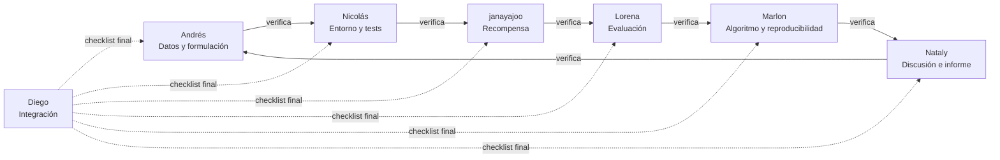
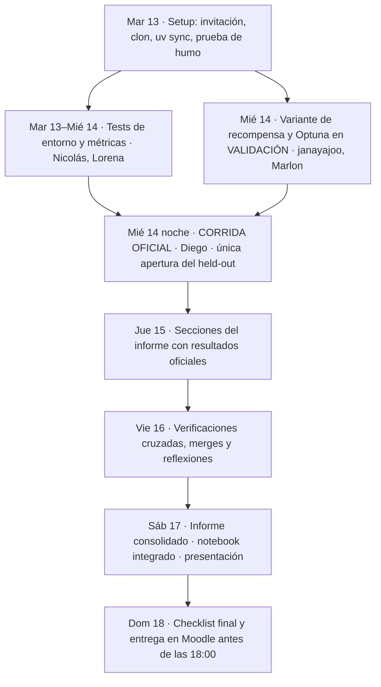

# Estructura de trabajo del equipo

Cómo nos organizamos los 7 integrantes para construir y entregar el proyecto **Agente Inversor**. El detalle de cada función está en [`docs/guia_equipo/`](docs/guia_equipo/). Este documento es el mapa general.

**Entrega:** domingo 18 de octubre de 2026, 23:59, en Moodle (meta interna: 18:00) · **Repositorio:** https://github.com/dialrigo/agente-inversor

---

## 1. Principio: producir y verificar

Cada integrante tiene dos funciones:

- **Producción:** construye una parte de la entrega (código, experimento o sección del informe) y la sube con **commits propios** en **su rama**.
- **Verificación:** revisa la parte de otro compañero con un checklist, como *reviewer* de su Pull Request.

Nada entra a `main` sin la aprobación del verificador y el CI en verde.

## 2. Funciones y entregables

| Integrante | GitHub | Función de producción | Entregables | Rúbrica | Verifica a |
|---|---|---|---|---|---|
| Diego Ríos | `dialrigo` | Integración, corrida oficial, presentación y entrega | Notebook ejecutado, `results/`, presentación, entrega en Moodle | Todas | Todos |
| Andrés Díaz | `andresdila` | Datos, EDA y formulación | `docs/informe/02_datos_eda.md`, `03_formulacion.md` | 1 | Nicolás |
| Nicolás Gamboa | `JnicolasGh` | Entorno y pruebas automáticas | `tests/test_investor_env.py`, CI con pytest, `docs/informe/04_entorno.md` | 2 | janayajoo |
| — | `janayajoo` | Diseño e iteración de la recompensa | `configs/investor_dqn_log.yaml`, `docs/informe/05_recompensa.md` | 3 | Lorena |
| Lorena Valero | `LorenaValero20` | Evaluación held-out, baselines y anomalía | `tests/test_metrics.py`, `docs/informe/07_evaluacion.md`, `08_anomalia.md` | 4 | Marlon |
| Marlon Umbarila | `Marlon-Umbarila` | Algoritmo, Optuna, semillas y reproducibilidad | `docs/experimentos/optuna_y_semillas.md`, `docs/informe/06_algoritmo.md`, `10_reproducibilidad.md` | 2, 4, 5 | Nataly |
| Nataly Valbuena | `natavalbuenal` | Discusión, referencias e informe final | `docs/informe/01_introduccion.md`, `09_discusion.md`, `11_referencias.md`, informe Word/PDF | 5 | Andrés + reflexiones |
| Los 7 | — | Reflexión individual | `docs/reflexiones/<usuario>.md` | 5 | Nataly |

Los checklists completos de "Produce" y "Verifica a" de cada integrante están en [`docs/guia_equipo/01_funciones_y_checklists.md`](docs/guia_equipo/01_funciones_y_checklists.md).

## 3. Anillo de verificación

Cada etapa la revisa quien depende de ella o quien la usa después:



## 4. Flujo de la entrega



## 5. Dónde vive cada cosa

```
agente-inversor/
├── README.md                     ← descripción técnica del proyecto
├── README_ESTRUCTURA_TRABAJO.md  ← este documento
├── CONFIGURACION_KERNEL.md       ← instalar uv, Python 3.11 y el kernel de VS Code
├── notebooks/Agente_Inversor.ipynb   ← solo lo edita Diego
├── src/rl_games_sb/              ← entorno, datos, evaluación (+ base del profesor)
├── configs/                      ← hiperparámetros por versión de recompensa
├── tests/                        ← pruebas (Nicolás, Lorena)
├── results/                      ← figuras y métricas de la corrida oficial
└── docs/
    ├── guia_equipo/
    │   ├── 00_LEEME_PRIMERO.md          ← plan, fechas y reglas
    │   ├── 01_funciones_y_checklists.md ← qué produce y qué verifica cada quien
    │   ├── 02_guia_ejecucion.md         ← cómo correr el proyecto
    │   └── 03_flujo_github.md           ← ramas, commits y Pull Requests
    ├── informe/          ← una sección del informe por archivo (dueño + verificador)
    ├── reflexiones/      ← una reflexión por integrante
    ├── experimentos/     ← Optuna y semillas
    ├── decisiones.md     ← bitácora: toda decisión nueva va aquí
    └── pendientes.md     ← ideas para después (sin desviarnos)
```

## 6. Cómo trabaja cada integrante (resumen)

1. Acepta la invitación del repo, clona y corre `uv sync` y `uv run python scripts/prueba_humo.py`.
2. Configura Git con el **correo de tu cuenta de GitHub**, para que tus commits cuenten como contribuciones.
3. Crea tu rama: `funcion/<tema>` para tu función y `reflexion/<usuario>` para tu reflexión.
4. Haz commits pequeños con este formato: `tipo(área): qué cambió`.
5. Abre el Pull Request y asigna a tu verificador como *Reviewer*. La plantilla ya trae el checklist.
6. Diego hace el merge cuando hay aprobación y el CI está en verde.

Comandos completos: [`docs/guia_equipo/03_flujo_github.md`](docs/guia_equipo/03_flujo_github.md).

## 7. Reglas de oro

1. **El held-out (2017–2018) se abre una sola vez,** en la corrida oficial. Todo ajuste se decide con la validación (2016).
2. **Los errores de código sí se corrigen,** aunque ya hayamos visto el held-out. Se documentan en `docs/decisiones.md` y se repite la corrida oficial.
3. **Una sola corrida oficial** alimenta el informe: la de Diego, en `results/`.
4. **Solo Diego edita el notebook.** Los demás escriben en `docs/informe/` y `docs/reflexiones/`.
5. **Nadie hace push directo a `main`.**
6. **Un resultado negativo bien explicado también es un buen proyecto.** La rúbrica premia la rigurosidad, no el retorno.

## 8. Rúbrica → responsables

| Criterio (1 punto cada uno) | Responsable principal | Apoyo |
|---|---|---|
| 1 · Formulación del problema | Andrés | Nataly (verifica) |
| 2 · Implementación del entorno | Nicolás | Andrés (verifica), Marlon (algoritmo) |
| 3 · Diseño de la recompensa | janayajoo | Nicolás (verifica) |
| 4 · Evaluación en held-out y baselines | Lorena | janayajoo (verifica), Marlon (protocolo) |
| 5 · Discusión, reflexión y reproducibilidad | Nataly y Marlon | Los 7 (reflexiones), Lorena (verifica) |
