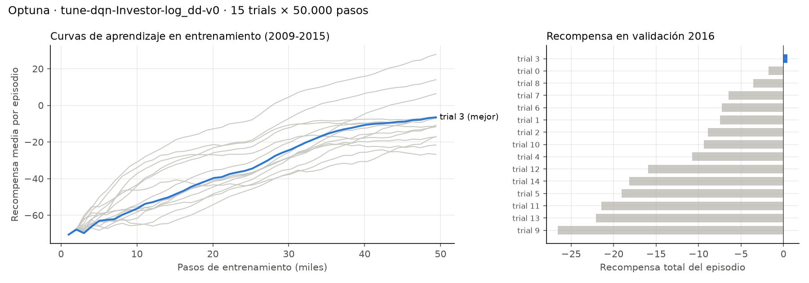

# Optuna y robustez por semillas

| Dueño | Verifica |
|---|---|
| Marlon Umbarila (`Marlon-Umbarila`) | Lorena Valero |

Todo se califica en **validación (2016)**, nunca en el held-out. Corridas hechas el 2026-10-17 en la máquina de Marlon (Windows, CPU), sobre la versión final de la recompensa, **v2 (log − drawdown)**, elegida por janayajoo en validación.

## Cómo se generó cada archivo de esta carpeta

Todos los comandos se corren desde la raíz del repositorio. Los tres pasos van **en este orden**, porque el paso 3 lee `mlflow.db`, la base local que crea el paso 1. `mlflow.db` no se sube al repositorio (está en `.gitignore`), así que quien quiera regenerar la figura debe correr antes la búsqueda de Optuna en su máquina.

| Archivo | Comando que lo genera | Qué contiene | Tiempo aprox. |
|---|---|---|---|
| `optuna_log.txt` | `uv run rlgames-sb tune --config configs/investor_dqn_log_dd.yaml *> docs/experimentos/optuna_log.txt` | Salida de consola de la búsqueda: los 15 trials con sus valores | 8 min |
| `semillas_investor_dqn_log_dd.csv` y `semillas_yaml_log.txt` | `uv run python scripts/semillas.py --config configs/investor_dqn_log_dd.yaml *> docs/experimentos/semillas_yaml_log.txt` | Versión final (YAML) con 4 semillas en validación | 8–10 min |
| `semillas_investor_dqn_log_dd_optuna.csv` y `semillas_optuna_log.txt` | `uv run python scripts/semillas.py --config configs/investor_dqn_log_dd_optuna.yaml *> docs/experimentos/semillas_optuna_log.txt` | Candidato de Optuna con 4 semillas en validación | 8–10 min |
| `optuna_trials.csv` y `optuna_curvas.png` | `uv run python scripts/exportar_optuna.py` (después de la búsqueda) | Tabla y figura de los 15 trials leídas de `mlflow.db`: hiperparámetros, recompensa en validación, recompensa final en entrenamiento y curvas de aprendizaje | < 10 s |

Para ver los mismos datos de forma interactiva: `uv run mlflow ui` → http://127.0.0.1:5000 → modo **Model training** (no "GenAI") → experimento `agente-inversor` → corrida `tune-dqn-Investor-log_dd-v0`.

En PowerShell, antes de redirigir la salida a un archivo, conviene correr `$env:PYTHONIOENCODING="utf-8"`; sin eso los acentos salen mal en los logs.

## Búsqueda Optuna

Comando: `uv run rlgames-sb tune --config configs/investor_dqn_log_dd.yaml` · log completo: [`optuna_log.txt`](optuna_log.txt)

- 15 trials × 50.000 pasos cada uno, sampler TPE con semilla 42 (la búsqueda es reproducible).
- Cada trial entrena un DQN nuevo en 2009–2015 y se califica con la **recompensa total del episodio de validación 2016** (`eval_env: Investor-log_dd-val-v0`, un episodio con política greedy). El held-out no interviene.
- Duración: **8 minutos** (17:26:40 → 17:34:38).

| Trial | learning_rate | γ | exploration_fraction | batch_size | Recompensa val. |
|---|---|---|---|---|---|
| 0 | 1,12 × 10⁻⁴ | 0,90 | 0,162 | 128 | −1,73 |
| 1 | 2,47 × 10⁻⁴ | 0,99 | 0,433 | 32 | −7,46 |
| 2 | 8,72 × 10⁻⁵ | 0,90 | 0,345 | 128 | −8,90 |
| **3** | **1,48 × 10⁻⁴** | **0,90** | **0,337** | **64** | **+0,47** |
| 4 | 3,77 × 10⁻⁵ | 0,95 | 0,222 | 64 | −10,76 |
| 5 | 4,60 × 10⁻⁵ | 0,99 | 0,204 | 32 | −19,05 |
| 6 | 2,04 × 10⁻⁴ | 0,95 | 0,476 | 128 | −7,24 |
| 7 | 4,09 × 10⁻⁵ | 0,99 | 0,255 | 64 | −6,48 |
| 8 | 8,03 × 10⁻⁵ | 0,99 | 0,130 | 32 | −3,54 |
| 9 | 3,06 × 10⁻⁵ | 0,90 | 0,409 | 64 | −26,55 |
| 10 | 1,85 × 10⁻⁴ | 0,90 | 0,309 | 64 | −9,37 |
| 11 | 2,01 × 10⁻⁴ | 0,90 | 0,107 | 64 | −21,41 |
| 12 | 5,87 × 10⁻⁴ | 0,90 | 0,111 | 128 | −15,95 |
| 13 | 3,02 × 10⁻⁴ | 0,95 | 0,201 | 128 | −22,06 |
| 14 | 7,16 × 10⁻⁵ | 0,90 | 0,188 | 128 | −18,18 |

**Lectura.** Solo 1 de los 15 trials termina con recompensa positiva en 2016, y la dispersión es enorme (de −26,6 a +0,5) sin un patrón claro por hiperparámetro: hay trials buenos y malos con γ = 0,9 y con γ = 0,99, con batch 32 y con 128. Eso indica que, con 50.000 pasos, el resultado en validación depende más del azar del entrenamiento que de los hiperparámetros, y que el "mejor trial" puede ser simplemente el más afortunado.

## Mejores hiperparámetros

| Hiperparámetro | YAML actual | Mejor de Optuna (trial 3) |
|---|---|---|
| learning_rate | 1,0 × 10⁻⁴ | 1,48 × 10⁻⁴ |
| γ | 0,99 | **0,90** |
| exploration_fraction | 0,30 | 0,337 |
| batch_size | 64 | 64 |
| Recompensa val. (50.000 pasos, semilla 42) | no evaluado en la búsqueda | +0,47 |

El cambio de fondo es γ: con 0,9 el agente mira un horizonte efectivo de ~10 días; con 0,99, de ~100 días. Los valores del trial 3 se guardaron en [`configs/investor_dqn_log_dd_optuna.yaml`](../../configs/investor_dqn_log_dd_optuna.yaml) (marcado como candidato, **no** oficial) para compararlos con el YAML en igualdad de condiciones.

## Curvas de aprendizaje de los trials (exportadas de MLflow)

Todo lo que MLflow registró por trial (hiperparámetros, curva de recompensa en entrenamiento y recompensa en validación) se exporta desde `mlflow.db` con `uv run python scripts/exportar_optuna.py`, para poder verlo en GitHub sin abrir `mlflow ui`. Tabla completa: [`optuna_trials.csv`](optuna_trials.csv).

**Lectura.** A la izquierda, todos los trials mejoran durante el entrenamiento: el agente sí aprende a desempeñarse en 2009–2015. A la derecha, ese aprendizaje no se traslada a 2016. **La correlación de rangos (Spearman) entre la recompensa final en entrenamiento y la recompensa en validación es −0,01**, es decir, nula. Los dos trials que más aprenden en entrenamiento, el 12 (+27,8) y el 13 (+14,0), están entre los peores en validación (−16,0 y −22,1); el mejor en validación, el trial 3, está a mitad del grupo en entrenamiento (−6,5). Es evidencia directa de **sobreajuste al periodo de entrenamiento** y de que el mercado de 2016 no se comporta como el de 2009–2015 (**no estacionariedad**): un agente que exprime mejor el pasado no decide mejor en el futuro.

## Semillas (RUN_SEEDS = True)

Comando: `uv run python scripts/semillas.py --config <config>` (mismo cálculo que el bloque `RUN_SEEDS` del notebook, sin editarlo). **150.000 pasos por semilla** (el entrenamiento completo, no los 50.000 de Optuna), evaluación greedy en validación 2016, mismo costo y capital que el resto del proyecto. Se corrieron los dos candidatos con las mismas 4 semillas para decidir con evidencia y no con un solo trial.

Archivos: [`semillas_investor_dqn_log_dd.csv`](semillas_investor_dqn_log_dd.csv), [`semillas_investor_dqn_log_dd_optuna.csv`](semillas_investor_dqn_log_dd_optuna.csv) y sus logs. Unos 2 minutos por semilla.

**A. Hiperparámetros del YAML (versión final v2)**

| Semilla | Retorno acum. % | Máx. drawdown % | Retorno / DD | Costos $ | Cambios de posición | Exposición media % | Sharpe |
|---|---|---|---|---|---|---|---|
| 42 | +6,12 | 6,27 | 0,98 | 2.982 | 31 | 17,7 | 0,76 |
| 1 | +6,08 | 6,10 | 1,00 | 2.980 | 33 | 16,9 | 0,70 |
| 7 | −2,53 | 12,31 | −0,21 | 2.456 | 32 | 16,3 | −0,23 |
| 123 | −3,95 | 10,76 | −0,37 | 3.817 | 53 | 27,3 | −0,32 |
| **Media ± desv.** | **+1,43 ± 5,42** | **8,86 ± 3,15** | 0,35 | 3.059 ± 563 | 37 ± 11 | 19,6 ± 5,2 | 0,23 ± 0,58 |

**B. Hiperparámetros de Optuna (trial 3)**

| Semilla | Retorno acum. % | Máx. drawdown % | Retorno / DD | Costos $ | Cambios de posición | Exposición media % | Sharpe |
|---|---|---|---|---|---|---|---|
| 42 | −6,46 | 14,59 | −0,44 | 4.614 | 59 | 27,9 | −0,48 |
| 1 | −13,03 | 20,54 | −0,63 | 6.158 | 82 | 44,0 | −0,96 |
| 7 | −4,90 | 13,92 | −0,35 | 5.396 | 72 | 30,3 | −0,40 |
| 123 | −5,42 | 9,29 | −0,58 | 4.573 | 60 | 25,5 | −0,45 |
| **Media ± desv.** | **−7,46 ± 3,78** | **14,59 ± 4,62** | −0,50 | 5.185 ± 751 | 68 ± 11 | 31,9 ± 8,3 | −0,57 ± 0,26 |

**Referencia en validación:** comprar y mantener = +4,24 % de retorno, 13,53 % de drawdown, retorno / DD = 0,31, 100 USD de costos.

**Interpretación.**

1. **El resultado de la v2 depende mucho de la semilla.** Con los hiperparámetros del YAML, 2 de 4 semillas ganan ~6 % con un drawdown de ~6 %, y las otras 2 pierden entre 2,5 y 4 %. La desviación del retorno entre semillas (5,4 puntos) es mayor que la diferencia media frente a comprar y mantener (−2,8 puntos), así que **en validación no se puede afirmar que la v2 le gane al mercado en retorno**. El +9,0 % de la corrida oficial en validación (semilla 42) es el extremo favorable de esta distribución, no un valor típico.
2. **Lo que sí es consistente es el control del riesgo.** Las 4 semillas del YAML tienen menor drawdown que comprar y mantener (6,1 a 12,3 % frente a 13,5 %) y una exposición media baja (16–27 %): la penalización por drawdown produce de forma estable un agente conservador, que pasa la mayor parte del tiempo en efectivo. Esto coincide con el "refugio en efectivo" descrito en `docs/informe/05_recompensa.md`.
3. **El "mejor" trial de Optuna no se sostiene.** Reentrenado con 150.000 pasos, pierde con las 4 semillas (−7,5 % en promedio), opera casi el doble (68 cambios frente a 37), paga 70 % más en costos y tiene más drawdown que el mercado. Su +0,47 en la búsqueda fue un resultado afortunado de una sola semilla y 50.000 pasos: un ejemplo directo de **sobreajuste a la validación** por seleccionar el máximo de 15 corridas ruidosas. Con γ = 0,9 el agente mira un horizonte más corto, persigue movimientos de pocos días y vuelve a la sobreoperación que tenían v1 y v3.
4. **Reproducibilidad entre máquinas.** La semilla 42 con el YAML da aquí +6,12 % de retorno y 6,27 % de drawdown; en la corrida oficial, +8,99 % y 8,61 %; en la corrida exploratoria de janayajoo, +8,48 % y 6,27 %. Mismo código y misma semilla en tres máquinas: la conducta coincide (31–32 cambios de posición, ~18–19 % de exposición), pero el retorno varía hasta ~3 puntos por diferencias numéricas de punto flotante que se acumulan durante el entrenamiento. Esa variación es menor que la variación entre semillas, pero no despreciable (ver `docs/informe/10_reproducibilidad.md`).
5. **Lo que anticipaban las semillas se vio en el held-out.** En la corrida oficial, la v2 obtuvo +3,5 % en 2017–2018 frente a +56,4 % de comprar y mantener, con un drawdown algo menor (13,9 % frente a 15,4 %): no le ganó al mercado en retorno, pero mantuvo un riesgo menor. Este resultado no se usó para ninguna decisión de este documento.

## ¿Adoptamos los nuevos hiperparámetros? Decisión y motivo

**No. Se mantienen los hiperparámetros de `configs/investor_dqn_log_dd.yaml` para la corrida oficial.**

Regla fijada antes de correr las semillas: adoptar los valores de Optuna solo si, reentrenados con 150.000 pasos, mejoran el criterio retorno / máximo drawdown en validación en al menos 3 de 4 semillas. Resultado: el candidato de Optuna es peor que el YAML en **4 de 4** semillas (retorno / DD medio −0,50 frente a 0,35). `configs/investor_dqn_log_dd_optuna.yaml` queda en el repositorio solo como evidencia del experimento.

**Sobre el orden de los hechos.** La corrida oficial (17:25) se hizo con los hiperparámetros del YAML mientras esta búsqueda seguía en curso; la búsqueda de Optuna (17:26–17:34) y las semillas (17:40–17:50) se calificaron **solo en validación**, con la regla de adopción escrita antes de correr las semillas, y sin consultar los resultados del held-out. Como la decisión fue no cambiar nada, la corrida oficial queda tal cual y no hace falta repetirla. Registrado en `docs/decisiones.md` el 2026-10-17.
